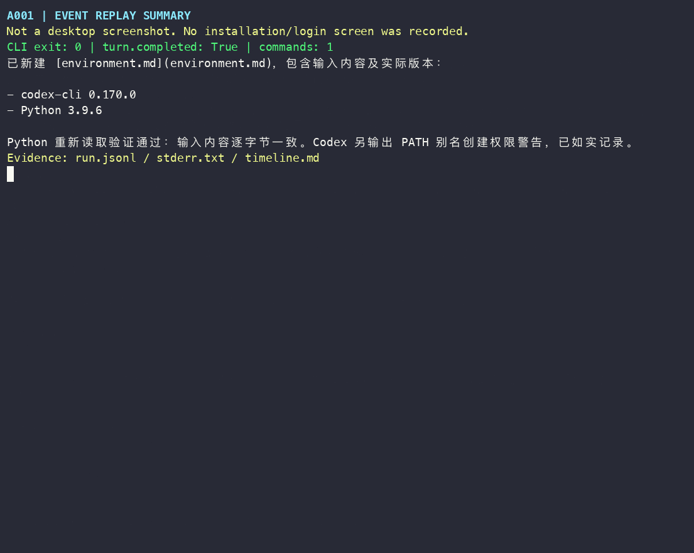
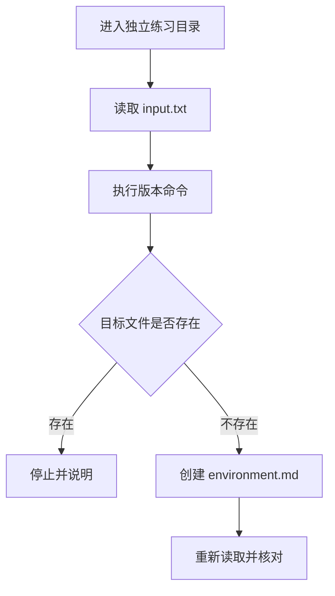
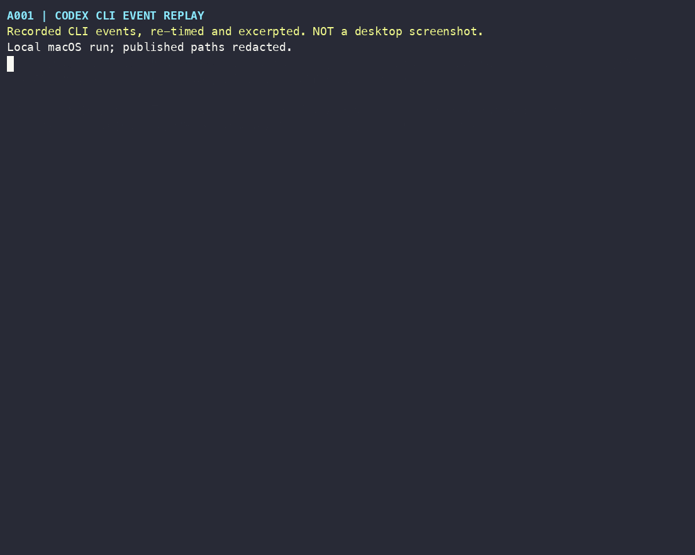

# 第1章：让 Codex 真正读写文件，先交付一份环境记录

Codex 已经装好了，终端里也能看到版本号，接下来是不是就能把项目交给它？先别急。版本命令只能证明客户端启动过；它能否读到你指定的文件、能否在正确目录生成结果，还需要做一次小任务。

这一章，我们只准备一句“环境练习”，让 Codex 读取它、运行版本命令，再生成 `environment.md`。任务很小，却能把后面开发工具要用到的几件事串起来：进入项目、提出要求、允许执行、打开成果、对照输入。

## 一、先看这次实际交付了什么



图1：CLI 真实事件的重放末帧。图中报告生成了 `environment.md`，记录 Codex 和 Python 版本，并完成重新读取验证。它是事件重放的静态帧，不是桌面应用截图。

读这张图，要看三个位置：输出文件名、实际版本、重新读取的核对结论。图中还有 PATH 别名权限警告，后面会单独说明，不能因为任务完成就把警告裁掉。


| 本章知识点 | 需要你做的事                 | 检查结果                   |
| ---------- | ---------------------------- | -------------------------- |
| 工作目录   | 在独立目录启动 Codex         | 输入和成果都在这个目录     |
| 任务约束   | 指定读什么、写什么、何时停止 | 不修改原输入，不覆盖旧成果 |
| 本地执行   | 让 Codex 实际运行版本命令    | 记录真实输出，不填写猜测值 |
| 文件验收   | 关闭后重新打开成果           | 内容一致、中文正常         |

本文实跑环境为 macOS 27.0.1、Codex CLI 0.170.0、Python 3.9.6，日期为2026年11月18日。这些是录制现场的版本，不是推荐你照装的版本。尤其是旧版 Python，新安装应从官方仍维护的版本中选择，并重新验证。Windows 操作尚未实测。

## 二、先准备入口，再准备目录

### 2.1 尚未安装时，从哪里开始

从 [Codex CLI 官方页面](https://developers.openai.com/codex/cli)选择与你系统一致的安装方式。本文的录制从“已安装且可以使用”的环境开始，没有重装客户端，也没有录到登录界面，因此下面是安装前的准备指引，不能当成本次安装实测。

如果你选择官方 npm 安装路径，先确认 Node.js 和 npm 已可用，再执行：

```sh
npm install -g @openai/codex
codex --version
```

第一条会安装软件，第二条检查客户端能否启动。不要在已经正常工作的电脑上反复安装，只为追求与教程相同的版本号。若选择了官方独立安装器，就沿着该路径完成，不必再叠加 npm 安装。

Python 单独从[官方下载页](https://www.python.org/downloads/)选择适合系统的版本。本例不要求安装第三方 Python 包。macOS 本次使用 `python3`；Windows 先确认 `python` 或 `py -3` 中哪一个可用，后续保持一致，不把三种命令轮番替换。

在项目目录运行 `codex`，按照客户端提供的登录方式完成认证。订阅、额度和账号条件以你的实际账户为准；购买本专栏不包含这些费用。不要把密钥贴进任务说明或截图。

### 2.2 把练习放到一个新目录

用文件管理器创建 `codex-ledger-lab`，其中再建 `ch01`。进入 `ch01` 后，新建 UTF-8 文本文件 `input.txt`，内容只有一行：

```text
环境练习
```

提交任务前，目录应当是：

```text
codex-ledger-lab/
└── ch01/
    └── input.txt
```

在终端进入这个 `ch01` 目录，再启动 Codex。这个顺序不要省：先确定目录，再交任务。若终端开在其他位置，模型可能正确执行了指令，却把文件放到了你没有检查的地方。

IDE 用户可以打开同一个目录作为对照入口，但本文图中的证据来自 CLI，不证明 IDE 已配置成功。首次跟做建议先选一种入口走通。

## 三、让任务有清楚的起点和终点

这次的处理关系如下：



图中的“停止”是我们给任务设定的要求，不表示动图里实际走过这个分支。录制时目标文件不存在，实际走的是创建和核对路径。

下面这段是实际执行任务的原始指令。你可以在 Codex 中提交同样的要求；其中“不使用网络工具”约束的是任务中的工具动作，Codex 获取模型回答本身仍需要相应服务连接。

```text
只操作当前练习目录，不访问其他项目、账号配置或私人文件。
只用 Python 标准库，不安装依赖，不使用浏览器、桌面控制或网络工具。
先简述计划，再真正执行命令，中文回复简短。
不能运行时如实说明，不伪造输出。已有目标不要覆盖。

读取 input.txt；实际运行 codex --version 和 python3 --version，
只新建 environment.md，写入输入内容与实际版本。
用 Python 重新读取验证文件与输入一致，报告结果。
```

这里没有要求“扮演专家”，而是明确了可以检查的动作。输入固定为一个文件，结果固定为另一个文件；版本必须来自执行；目标已存在就停止。后面换成开发任务，这几个位置仍然要讲清楚。

如果你的解释器命令不是 `python3`，先把指令中的对应位置改成已经验证过的命令。这个改写是环境适配，不要让模型猜测电脑上有哪些解释器。

## 四、顺着动图检查实际执行



图2：真实 CLI 事件经过路径脱敏、重新计时和长输出节选后的动图。它展示执行计划、命令事件和结果摘要，不包含安装、登录或鼠标操作。

这次 Codex 先说明计划，随后在一个命令事件里完成读取、版本检查、文件写入和重新读取。末帧中的 `commands: 1` 指一个被记录的命令执行事件，其中可以包含多条子操作，不应理解成只运行了一个简单命令。

打开本次的[环境记录文件](../assets/recordings/20261118T133012Z/A001/environment.md)，能看到版本信息与“环境练习”原文。我们需要自己打开文件，而不只依赖图片中的“验证通过”：模型对执行的总结也可能出错，文件才是这一步要交付的成果。

跟做时，依次核对：文件是否在 `ch01`；输入是否仍是那一句话；输出有没有遗漏中文；版本是否与实际执行一致。最后关闭编辑器，再重新打开一次。这个动作检查的是成果是否真正保存下来。

## 五、看到警告，先判断影响到哪一步

本次记录有两类异常信息。

一类是版本命令附带的 PATH 别名创建权限警告。命令仍输出版本并返回0，任务也创建了文件。它说明这次版本读取完成，但别名相关操作未成功，不能写成“环境没有任何问题”。

另一类来自外层 CLI 的标准错误：模型列表刷新多次超时。原始记录保留了 `failed to refresh available models: request timed out`。从本次结果能确认任务最终完成；至于超时原因，仅凭这条记录无法确定。不要把它归结成某个已证实的网络或账号故障。

你遇到类似情况时，先保留完整错误、命令和退出码，再区分“辅助动作失败”与“核心任务失败”。找不到命令就核对安装和终端环境；无法登录就按官方认证说明排查；目标已存在则换一个新输出名。不要直接删除旧文件，或为了继续而放开整个磁盘权限。

下面是遇到问题时可用的追问模板，并非本次实际发生的追加对话：

```text
先停止新的写入。请指出失败的是哪条命令、退出码和错误原文。
说明它是否阻止本次读取、创建和核对。
不要重装软件、修改系统权限或覆盖旧文件；先给出最小排查步骤。
```

## 六、把同样的方法带到下一章

本章验收不看回答长短，只检查：`environment.md` 存在、原输入未变、版本来自执行、输出可以重新打开。已有目标拒绝覆盖是指令要求，本次录制没有重新运行这个分支，不据此宣称该分支已完成实测。

想再练一次，可以新建 `ch01-second`，改成另一句合成文字，重新完成。保留旧目录，比较两个成果；不要在原目录里反复清空文件。下一章我们会放入四条收支记录，让 Codex 从空目录写出第一个汇总程序。

### 再补一步：权限请求也要对照任务

首次让 Codex 执行命令时，客户端可能按照当前配置请求授权。具体提示会随版本和设置变化，本文没有录下一个统一按钮流程，不能要求你照着不存在的按钮点击。判断时先看动作：读取本目录输入、执行版本命令、新建本目录结果，都与任务有关；读取其他项目、安装一组无关软件，则需要先停下来解释。

如果遇到拒绝写入，先确认目标目录和目标文件状态。不要把“没写成”直接理解为“必须提升权限”。练习目录放错位置、终端没有进入预期目录、旧目标已存在，都可能造成不同问题，应该先根据实际报错排查。

### 看文件内容时，允许它保留真实异常

本次 `environment.md` 里，版本段不只有两条整齐的版本号。PATH 警告也随实际版本命令输出保留下来了。教程没有把文件重新美化后再冒充原输出，因此它与末帧中的简短摘要不是完全相同的排版。

读者可以据此练习区分“摘要”和“原始材料”：图片帮助定位重点，原文件用于逐字核对，事件记录说明做过哪些动作。三者各有用途，不能只保留最漂亮的那一个。换到后面的账单任务，同样要保留原输入和真实程序结果，才能判断文字说明是否准确。
