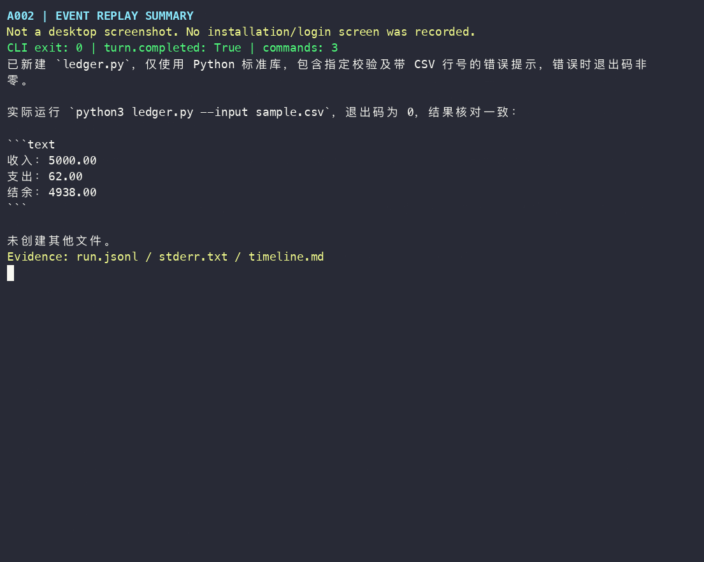
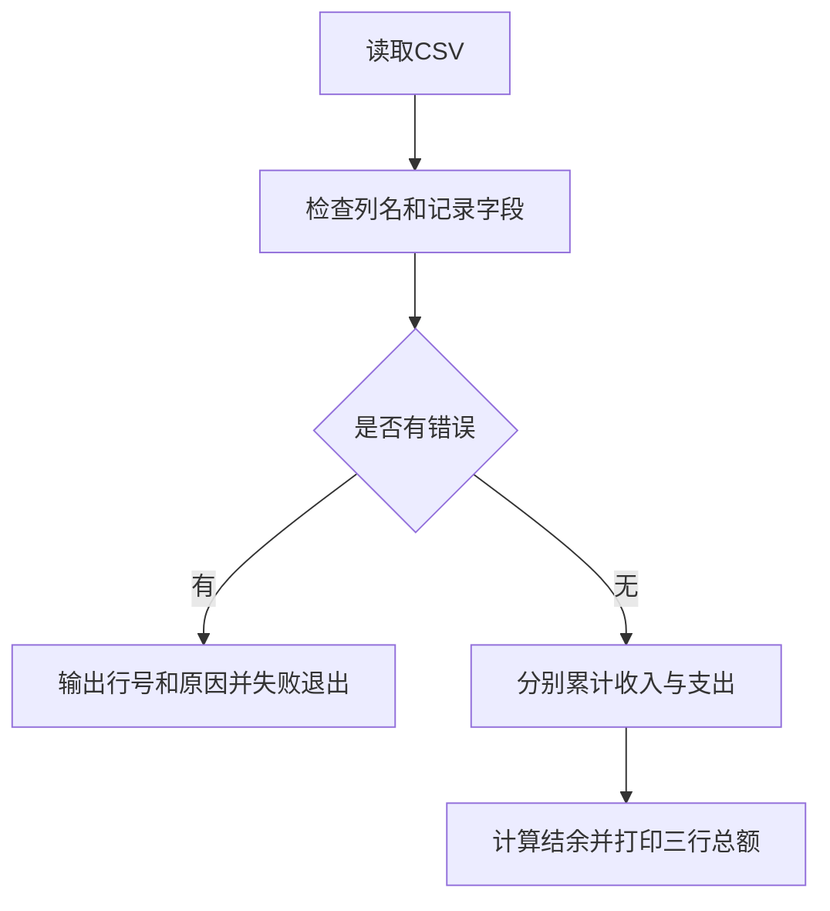
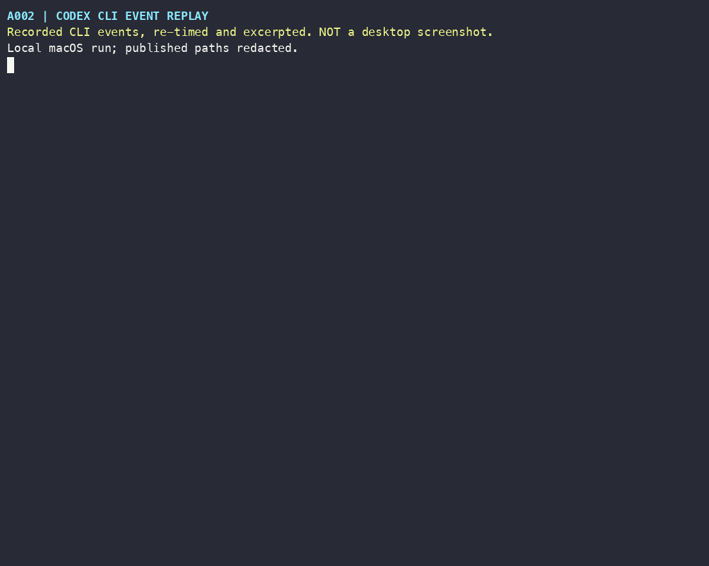

# 第2章：从四条 CSV 记录开始，让 Codex 写出第一个汇总工具

一份收支表，只有四条记录，用计算器很快就能算完。我们仍然拿它来开发程序，是因为答案足够明确：程序算错了，不用再请模型判断模型的答案。

上一章已经确认 Codex 能读写练习目录。这一章，我们把任务换成“读取 CSV，打印收入、支出和结余”，先做一个可以运行的小工具。分类、导出和图形界面暂时不加，等三项总额正确后再往前走。

## 一、这次的终点是三行结果



图1：本次 CLI 事件重放末帧。Codex 新建了 `ledger.py`，执行程序，输出收入5000.00、支出62.00、结余4938.00。图片是事件摘要，不是编辑器或终端窗口截图。


| 本章知识点     | 用在什么地方                 | 本章成果                   |
| -------------- | ---------------------------- | -------------------------- |
| 输入和输出约定 | 固定 CSV 列名与命令参数      | `--input sample.csv`       |
| 任务拆分       | 先核算总额，再扩展功能       | 一个可运行的`ledger.py`    |
| 十进制金额     | 从文本转换为 Decimal         | 两位小数的汇总结果         |
| 错误处理       | 错误数据要定位，不能静默跳过 | 行号、错误原因和非零退出码 |

先完成第1章，再在 `codex-ledger-lab` 下新建 `ch02`。本章不需要重新安装 Codex，也不需要 `pip install`。CLI 与 Python 使用上一章已经确认的环境；Windows 路径和命令仍待实测。

## 二、把答案写在运行之前

在 `ch02` 内创建 UTF-8 的 `sample.csv`，复制以下合成数据：

```csv
日期,类型,类别,金额,备注
2026-11-01,收入,工资,5000.00,合成样例
2026-11-02,支出,餐饮,28.50,午餐
2026-11-03,支出,交通,12.00,车费
2026-11-04,支出,餐饮,21.50,晚餐
```

不要使用银行账单或真实家庭收支来替换入门样例。格式、处理范围和服务的数据条件都还没有经过你的实际核对，先用合成数据把方法跑通。

在纸上或编辑器里先算一次：收入只有5000；支出为28.50加12.00加21.50，合计62；结余等于5000减62，为4938。这里的“结余”仅指这份输入里的收入减支出，不包含期初余额，也不是完整账户余额。

如果输入只有一条工资，模型即使用一个写死答案的脚本，也可能看起来正确。因此我们保留多种支出；后面的迁移练习还会换数据。手工预期要先于程序输出确定，不能看到程序算出什么，再把验收答案改成什么。

本章起始目录只有：

```text
ch02/
└── sample.csv
```

需要直接检查本次结果，可查看[实际生成的程序](../assets/recordings/20261118T133012Z/A002/ledger.py)与[原始样例](../assets/recordings/20261118T133012Z/A002/sample.csv)。建议先自己跟做，再对照附件；若一开始就复制成品，便体验不到从需求到文件的过程。

## 三、把业务要求变成可执行指令

程序要遵循以下关系：



“有错就停止”很关键。如果程序悄悄丢掉一条读不懂的支出，剩下的结果仍然能算得整整齐齐，读者却不知道数字已经不完整。

进入 `ch02`，启动 Codex，提交下面的本章任务。这是本次实跑要求的分行整理版，原始文字保存在[任务附件](../assets/recordings/20261118T133012Z/A002/prompt.txt)：

```text
只操作当前练习目录，先读 sample.csv，确认 ledger.py 不存在。
从零新建 ledger.py，只用 Python 标准库，不安装依赖。

用 argparse 接受 --input；按 utf-8-sig 读取 CSV。
列名为：日期、类型、类别、金额、备注。
用 Decimal 按收入和支出累加，打印收入、支出、结余，两位小数。
不做分类汇总，不导出报告，不创建其他说明文件。

缺列、非法类型或日期、空类别、负金额、NaN、超过两位小数
都要报告 CSV 行号并以非零退出码结束；空表输出零。
先简述计划，再实际创建和运行，不伪造输出，不覆盖已有目标。
运行 python3 ledger.py --input sample.csv，核对5000.00、62.00、4938.00。
不访问其他项目、私人文件，不使用浏览器或网络工具。
```

这段要求包含了接口、业务规则和验收结果。“只用标准库”限制依赖，“不做分类和导出”限制范围，“错误给行号”则决定了出了问题时能不能继续排查。它们比一句“做得专业些”更有操作价值。

若 `ledger.py` 已经存在，不要照搬“从零新建”的要求。先确认文件是不是自己的旧成果，换一个新目录开始。误把已有文件当成空项目，是很多不必要覆盖的起点。

## 四、看动图：先检查输入，再创建程序



图2：Codex 先确认当前目录和文件，再读取样例，最后创建程序并运行。动图按真实事件重排时间，长命令和输出有节选；完整内容见文末事件记录。

本次记录了三个命令执行事件，分别用于查看目录、读取输入、创建并运行程序。最后一个事件包含写代码和调用程序，所以图片中的事件数量不等于代码行数，也不等于全部子命令数量。

你跟做时，若模型只在对话里贴出代码，可以要求它说明文件是否实际落盘、路径在哪里；不要把“下面是实现”误认成“文件已经生成”。如果它提出安装额外数据分析库，先让它解释为什么当前 CSV 任务需要这些依赖。

生成后，自己在 `ch02` 再运行一次：

```sh
python3 ledger.py --input sample.csv
```

本次实际输出为：

```text
收入：5000.00
支出：62.00
结余：4938.00
```

退出码为0，表示这个程序正常结束。它不能单独证明金额正确，三个值仍要与手工计算对照。若输入缺失，应该看到读取错误和非零退出；不要为了得到三行输出而让程序在缺文件时返回一份默认账单。

## 五、不必逐行背代码，但要看懂三个位置

### 5.1 输入按列名解释

实际程序检查五个必需列，再建立列名到位置的对应关系。CSV 用标准库解析，不简单地把每行按逗号硬拆开；备注中合法出现逗号或引号时，格式处理才有依据。

BOM 可以理解为某些 UTF-8 文件开头的编码标记，`utf-8-sig` 能处理带该标记的输入。本次独立检查也验证了 BOM 情况，但不能据此声称所有 Excel 导出的编码都兼容，其他编码需要单独处理。

### 5.2 金额从原始文本转换

实际程序包含这样的转换：

```python
amount = Decimal(fields["金额"])
```

这一句是从生成程序中摘出的片段，不是完整脚本。金额直接由文本交给 `Decimal`；后续再检查是不是有限值、是不是负数、小数位是否超出要求。不要先转成 `float`，再期待格式化成两位小数就消除全部误差。

本次代码还使用了局部精度设置。这里先知道它与较大金额的累计有关，不必在第一次开发时展开全部数值细节；若要接入生产财务数据，金额上限、舍入和业务口径都要另立规则。

### 5.3 出错时不给部分成功结果

程序可以在内存里累加已经读过的有效记录，但发现任何错误后，会打印错误并返回1，不再给出正式的三项总额。这个区别很实用：内部曾经算过几行，与向用户交付一份完整汇总，是两件事。

## 六、换一份输入，检查它是否真会计算

先复制样例为 `sample-second.csv`，只在副本增加一条支出10.00。新的手工预期应为支出72.00、结余4928.00。用同一程序指定新输入运行，检查它有没有仍然打印旧的62.00。

这是供读者跟做的迁移练习，不是动图中已录制的步骤。练习前不要改掉原样例，否则后面就失去统一的比较依据。

输出不对时，可以使用下面的追加指令：

```text
保留当前程序和错误输出。先对照 sample-second.csv 逐行说明收入、支出。
指出与手工预期不符的第一处，不要先改验收答案。
说明拟修改的代码位置，修复后同时运行原样例和新样例。
```

这一章合格的成果是：程序确实存在、参数能用、三项总额与手工预期一致、原样例未被改写。下一章会在副本上增加支出分类与报告导出，原版仍然保留。

### 先确认数据口径，再谈提示词写法

样例里的金额都为正，收入或支出由“类型”列区分。如果你拿一份支出已经写成负数的账单直接套用，当前程序会拒绝它。正确做法是先明确是否需要转换数据口径，而不是让 Codex 删除负数检查。否则同一笔钱可能既带负号，又在支出累计时被再次扣减。

日期也遵循本次约定的 `YYYY-MM-DD` 格式。把“周五”或“11月初”放进日期列，不应期待程序自动猜成某一天。对于这种资料，应先在独立的整理步骤里确认日期，再进入计算；自动提取和数值计算不宜在这个小工具里混成一个无法核查的动作。

### 代码看起来变长，哪些内容值得保留

本次生成的脚本并不只有几行加法。读取错误、日期检查、金额异常和退出码占了不少篇幅。这些代码对应的是已经写入任务的要求，不宜为了让文章显得轻松而全部省略，再让读者到真实文件上自行发现问题。

第一次阅读可以沿着输入、校验、累加、输出四个位置走，不必背下每个异常名称。若看不懂某段，让 Codex 指出它对应哪条需求，并用一个合成输入解释触发条件。解释完再回到实际代码核对，避免只接受一段与实现无关的通用答案。
