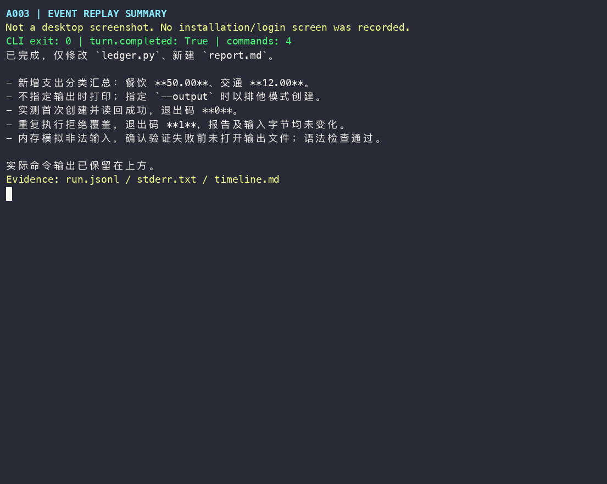
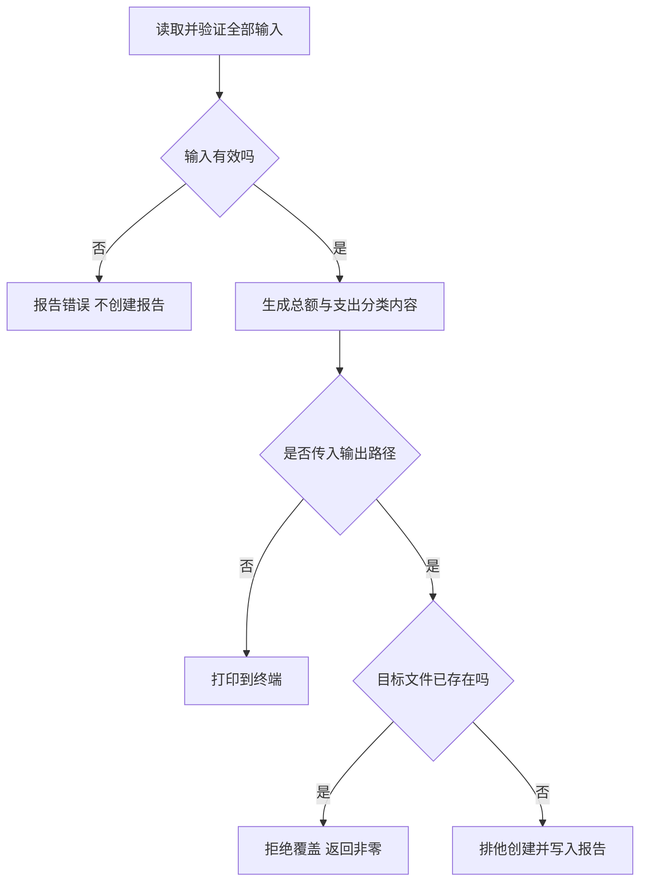
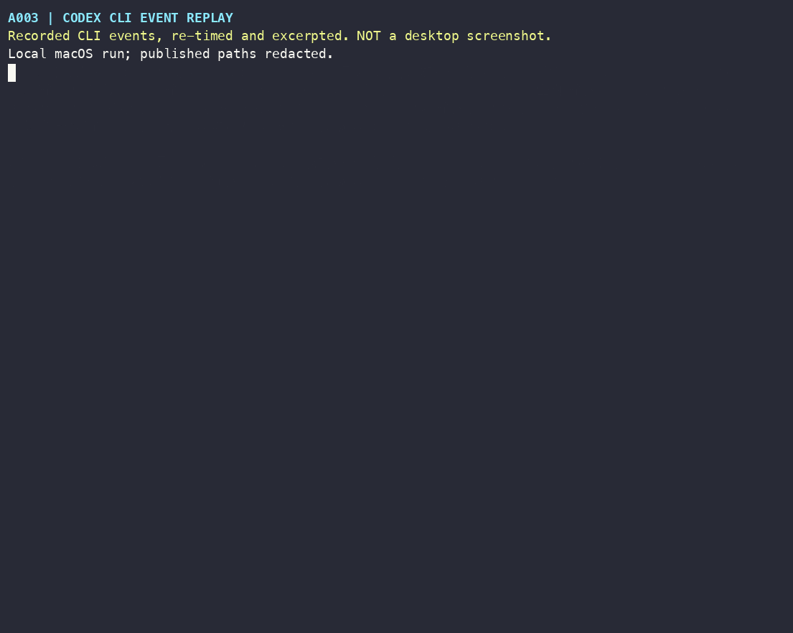

# 第3章：在已有程序上加功能，导出一份不会覆盖旧文件的报告

终端里已经能算出结余，下一步往往就会想到：能不能看看钱花在哪，又能不能把结果留下来？这次我们只加这两个功能——支出分类汇总，以及 Markdown 报告导出。

已有程序要继续保留。让 Codex 从头再写一个“更完整的版本”，看似省事，却可能把上一章已经确认过的日期检查和金额规则一起换掉。我们改在副本中增量开发，再用同一份样例核对老功能。

## 一、图中两种退出码，都要看懂



图1：真实事件重放末帧。本次首次导出返回0，重复导出返回1；同时核对了旧报告与输入字节没有变化。这是 CLI 事件摘要，不是报告软件的截图。

返回1没有让本章验收失败，恰恰是因为第二次运行试图使用已经存在的输出名。我们要求程序拒绝覆盖，它就应该报告原因并失败退出。运行工具的人要看任务意图，不能把所有非零退出码都改成0。


| 本章知识点 | 本次只增加什么     | 验收依据                   |
| ---------- | ------------------ | -------------------------- |
| 增量需求   | 在第二章副本上修改 | 老样例的三项总额不变       |
| 分类累计   | 仅汇总支出类别     | 餐饮50.00、交通12.00       |
| 可选参数   | 增加`--output`     | 不传则打印，传入则创建报告 |
| 输出保护   | 已存在的目标不覆盖 | 返回1，报告和输入字节不变  |

## 二、先把第三章目录准备好

在 `codex-ledger-lab` 下新建 `ch03`，复制第二章的 `ledger.py` 和 `sample.csv`。不要把第二章目录直接改名，也不要提前把本章成品放进去。

```text
ch03/
├── ledger.py       ← 第二章的副本
└── sample.csv      ← 同一份合成样例
```

本次录制的起点也没有 `report.md`。如果你的目录里已经有这个文件，先确认来源，换一个新目录或输出名再做首次导出；不要无条件删除文件，制造“空目录”。

运行一次旧命令，仍应得到收入5000.00、支出62.00、结余4938.00。然后算出本章的新预期：两笔餐饮28.50与21.50相加为50.00，交通为12.00；50加12应回到总支出62。

分类口径只涵盖“支出”。收入中的工资不会列入支出分类。以后想按月份、收入类型或账户分析，应作为新的明确需求提出，不让模型顺手扩展。

## 三、把新功能写成一份小改动单

处理流程如下：



先验证再写入，是为了避免输入第六行报错，文件里却已经留下前五行的部分汇总。输出名冲突则要由创建操作本身拒绝，不能只在写入之前问一次“存在吗”。

进入 `ch03`，向 Codex 提交以下要求。它按实跑任务分行整理，原始文字在[本章指令附件](../assets/recordings/20261118T133012Z/A003/prompt.txt)：

```text
先读取 ledger.py 和 sample.csv，在本章副本增量修改。
只用 Python 标准库，不安装依赖，不访问其他项目或私人文件。
保留原来的输入校验和三项总额，增加支出分类汇总。

增加可选 --output：不传时打印；传入路径时导出 Markdown 报告。
指定输出要用排他创建，目标已存在时返回非零，不修改旧文件。
全部输入验证通过后才写报告。

先创建 report.md 并重新读回，再重复执行相同命令。
核对第二次拒绝覆盖，以及报告和输入的字节均未变化。
分类预期：餐饮50.00，交通12.00。
只修改 ledger.py、新建 report.md，最后说明实际执行与检查结果。
不使用浏览器、桌面控制或网络工具，不伪造输出。
```

这份要求没有把第二章整个任务重述一遍，而是明确哪些行为保留、哪些行为新增，以及怎样验证。这是以后维护小项目时更常用的交付方式。

## 四、对照动图，把两条路径各跑一次



图2：Codex 读取已有脚本后增量修改，随后执行打印、首次导出、重复导出和输入错误检查。动图有长输出节选，完整命令事件保存在本章记录中。

本次实际生成的[程序](../assets/recordings/20261118T133012Z/A003/ledger.py)与[报告文件](../assets/recordings/20261118T133012Z/A003/report.md)可以下载对照。不要混用上一轮教程的其他示例代码；这里引用的是图中这一次任务的交付文件。

### 4.1 先保留终端打印能力

在 `ch03` 运行：

```sh
python3 ledger.py --input sample.csv
```

这次打印仍有三项总额，并增加支出分类。若老金额改变，先停下来查差异；不要因为新功能看起来不错，就忽略之前通过的结果。

### 4.2 再创建报告

确认 `report.md` 尚不存在后运行：

```sh
python3 ledger.py --input sample.csv --output report.md
```

本次返回0，标准输出为空。程序把结果写进了文件，不要求同时把整份报告再打印一次。运行后重新打开 `report.md`，实际内容为：

```markdown
收入：5000.00
支出：62.00
结余：4938.00

## 支出分类汇总

餐饮：50.00
交通：12.00
```

这份报告刻意保持简单：数值能核对、文本能重开、换个支持 Markdown 的编辑器也能读。当前没有图表和复杂样式，截图中的强调符号来自模型回复，不代表报告正文也使用了相同排版。

### 4.3 使用同一输出名再执行

保留已经生成的报告，再运行上一条导出命令。本次实际返回1，错误输出为：

```text
报告写入失败：[Errno 17] File exists: 'report.md'
```

记录随后输出了报告和输入字节不变的核对结果，并保留摘要值。不要仅凭文件名还在，就认定原件没有变化：内容也可能已经被替换。字节比较检查的是实际内容。

如果需要新的报告，用 `report-second.md` 等新名字。当前版本没有自动覆盖开关，也没有承诺自动恢复整个项目；我们不为了方便演示而临时加一个默认覆盖选项。

## 五、检查代码时，盯住两个改动点

第一处是支出分类累加。实际生成程序只在类型为“支出”的路径上更新类别金额。做审查时，可以先找 `categories` 的更新位置，再确认工资收入没有走进这条路径。

第二处是文件创建方式。实际程序写入报告的片段如下：

```python
with open(args.output, "x", encoding="utf-8", newline="\n") as stream:
    stream.write(report)
```

这段是从实跑代码摘出的片段。`x` 表示排他创建，目标存在就失败；如果改成 `w`，原文件通常会被截断后重写，含义完全不同。不要让 Codex 为了消除本章的“文件已存在”错误，把这里悄悄改成覆盖模式。

本次还在内存中追加了一条非法金额记录，验证输入失败时没有尝试打开输出文件。它没有改写原始 `sample.csv`。这项验证说明当前处理顺序符合要求，但不代表磁盘损坏、写入中断等所有情况都有恢复保障。

## 六、功能有了，怎样避免下一次改坏

你可以在副本中新添一类支出“图书”，让它生成新报告；先自己计算总额与类别金额，再让程序跑。这个迁移练习需要独立验收，不能拿原样例的50.00和12.00套过去。

如果导出时遇到问题，追问尽量落到操作上：

```text
请保留当前输入和旧报告。说明是输入验证失败、目标已存在，还是写入失败。
给出实际退出码和错误，不改成覆盖模式，不删除旧文件。
先检查原输入及旧报告是否变化，再提出最小修改方案。
```

本章通过条件为：老总额不变、两项支出分类正确、报告读回一致、重复导出拒绝覆盖、原输入未变。图中已经实测的内容到这里为止。下一章把这些检查写成测试，换一次代码也能重新执行。

### 读差异时，不只看新增功能

第二章和第三章各保留一份脚本，是为了让你可以比较改动。审查时先找新增参数和分类累计，再向前确认日期、类型、金额检查是否还在；最后看输出分支是否只在验证通过后执行。这里需要的是有目的的阅读，不要求逐行记忆全部程序。

若模型声称“只加了导出”，实际却重写了输入处理，先让它解释额外改动。合理改动可以保留，但要重新检查受影响的行为。不要把“代码更简洁”直接等同于“修改更正确”。本次附件保留了录制产生的版本，正文没有另换一份更好看的实现来解释同一张图。

### 分类顺序与金额正确，是不同的验收要求

本次报告先列餐饮、后列交通，与样例中支出类别首次出现的次序相符。当前代码使用字典累计并按其遍历顺序输出，没有承诺按金额从大到小排序。若以后调换输入记录，分类排列可能变化，即使分类金额仍然正确。

想增加排序，应在下一次需求里明确“按类别名”还是“按支出金额”，再相应修改测试。不能只因为一份报告顺序不合心意，就让模型改动数据本身。报告样式和业务数值要分别判断。

### 报告格式也要遵循实际交付

Markdown 文件可以先用普通文本编辑器核对，再用支持 Markdown 的工具查看排版。本次文件使用二级标题分开分类部分，没有表格和图表；它的首行是收入，不是另加的报告封面标题。若你给它重新排版，应说明这是展示版本，同时保留实际生成文件，避免把设计效果当成程序已经实现的功能。
