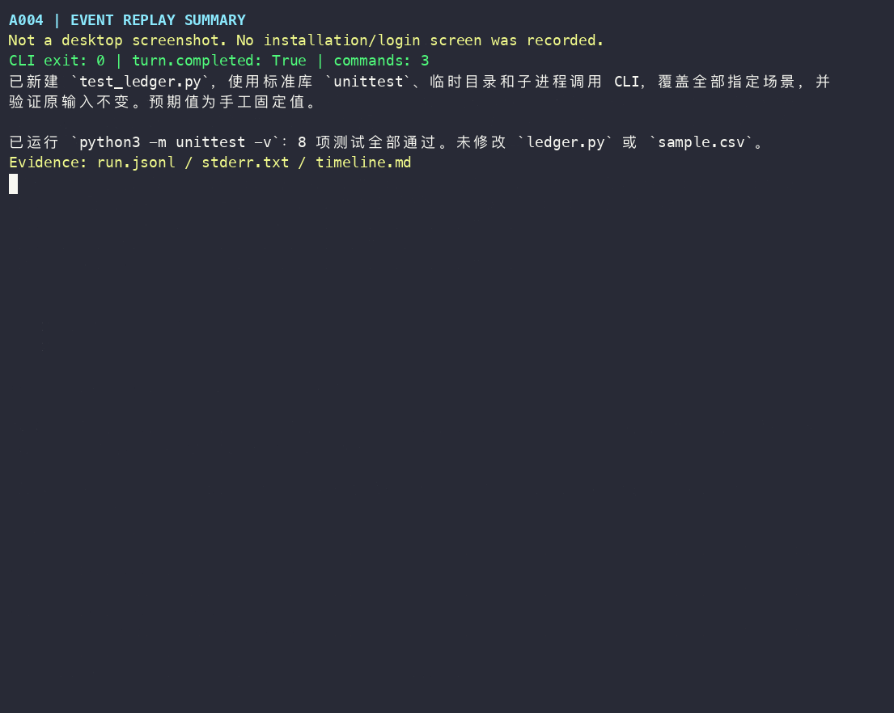
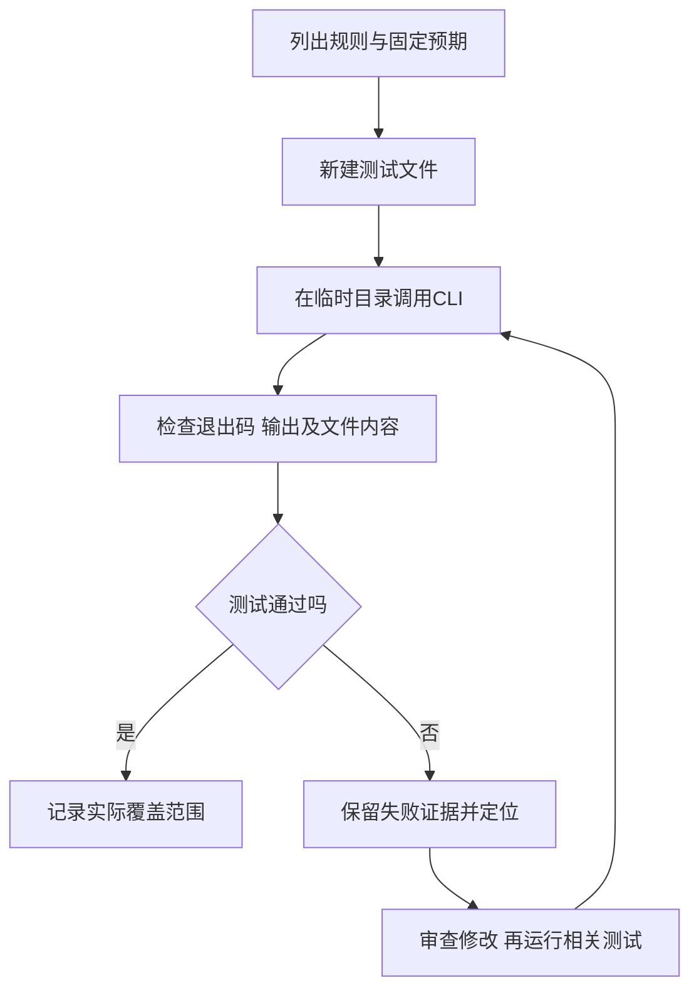
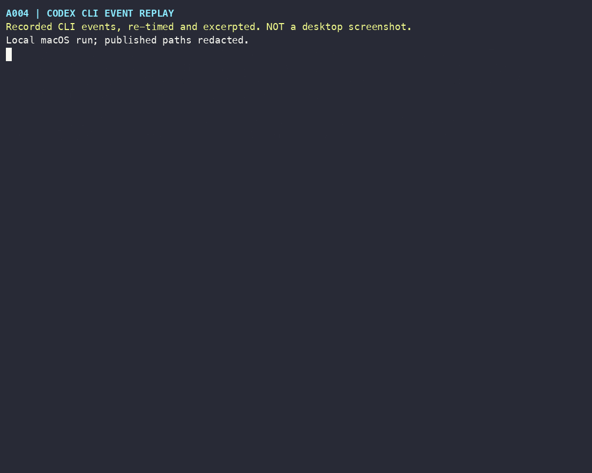

# 第4章：用8项测试验收小工具，把金额、报告和原件一起检查

程序能处理四条样例，说明这组输入跑通了。换成缺列、错误日期，或者把输出路径误写成原始账单，它还能按要求停止吗？这些情况若每次都靠手动操作检查，很容易漏掉。

这一章，让 Codex 为上一章程序补一份测试。我们提前固定预期，再让测试调用真正的命令行入口。检查的对象不只是一句“运行成功”，还包括返回码、输出内容，以及原文件有没有变化。

## 一、图中没有发生修复，就不补一段修复故事



图1：真实事件重放末帧。本次新建 `test_ledger.py`，执行8项测试，全部通过；没有修改 `ledger.py` 或 `sample.csv`。图片是 CLI 事件摘要，不能当作编辑器或测试面板截图。

本章标题因此采用“验收”，而不写“定位并修复一个 Bug”。失败后如何处理仍然值得讲，但它会作为读者可使用的排错方法，与这次实际发生的过程分开。


| 本章知识点 | 用在什么地方               | 交付物                   |
| ---------- | -------------------------- | ------------------------ |
| 固定预期   | 不让程序输出反过来决定答案 | 手工核算的总额与报告文本 |
| 命令行测试 | 从用户实际入口调用工具     | 子进程输出和退出码       |
| 临时目录   | 隔离错误样例和目标冲突     | 不污染课程原件的测试数据 |
| 原件保护   | 每次运行后核对输入与旧输出 | 文件内容不变的断言       |

## 二、先建立本章副本，再列清检查范围

在 `codex-ledger-lab` 下新建 `ch04`，复制第三章的 `ledger.py` 和原样例。保留第三章目录。起始时本章只有两个文件，测试生成后才增加第三个：

```text
ch04/
├── ledger.py
├── sample.csv
└── test_ledger.py    ← 本章要新建
```

不必复制第三章的 `report.md`，因为测试会在临时目录内创建输出。这样同名文件不会互相干扰，也不会把“之前已经生成了报告”误判成程序导出失败。

本次最终得到8个测试方法，其中一个方法又使用多组非法记录作子测试。`Ran 8 tests` 统计的是测试方法，不是说只检查了8份输入，更不表示程序只可能有8种风险。


| 实际测试方法                        | 核对的行为                                            |
| ----------------------------------- | ----------------------------------------------------- |
| `test_sample_totals_and_categories` | 三项总额、两类支出及完整文本一致                      |
| `test_bom`                          | 带 UTF-8 BOM 的样例仍可读取                           |
| `test_empty_tables`                 | 空文件与只有表头的文件按零值输出                      |
| `test_invalid_records`              | 缺列、少字段、错误日期或类型、负数、NaN、三位小数失败 |
| `test_missing_input`                | 缺失输入时返回错误，不生成报告                        |
| `test_generate_report`              | 创建报告，文件字节与固定预期一致                      |
| `test_refuse_overwrite`             | 旧输出不被覆盖                                        |
| `test_refuse_output_equal_to_input` | 输出误指向输入时拒绝写入                              |

这个表先帮你理解图中的“8项”具体指什么。下一次增功能，先决定哪些行为需要新测试，不要把测试数量当成完成度分数。

## 三、让 Codex 写测试，先把答案固定住

本章处理路线如下：



本次实际走的是“通过”分支。“失败—修复”的箭头表达之后遇到失败时怎么处理，不是这张动图里发生过的事件。

进入 `ch04` 后提交以下要求。这是[实际指令](../assets/recordings/20261118T133012Z/A004/prompt.txt)的分行整理版：

```text
读取本章 ledger.py 和 sample.csv，仅新建 test_ledger.py。
只用标准库 unittest、临时目录和子进程调用 CLI，不安装测试框架。

测试样例总额与分类、BOM、空表、缺列、非法日期或类型、
负数、NaN、三位小数、输入不存在、报告生成、拒绝覆盖及原输入不变。
手工预期不能随程序输出改动。
运行 python3 -m unittest -v。

若失败，先保留失败输出，再修 ledger.py 并重新运行；
没有失败不要构造修复故事。只操作当前练习目录，不访问私人文件，
不使用浏览器、桌面控制或网络工具，不伪造运行结果。
```

“手工预期不能随程序输出改动”很重要。若测试先调用程序拿到结果，再把这份结果原样当作下一次的正确答案，程序原有的错误也可能被保存成标准。

要求从 CLI 入口测试，是因为读者实际使用的是 `python3 ledger.py ...`。只测试内部某个加法函数，可能漏掉参数、文件路径或输出保护的问题。这里并不意味着所有项目都只能做命令行测试，而是让检查入口与本章工具的交付方式一致。

## 四、对照动图，执行这一次的测试



图2：Codex 先确认文件和读取代码，随后创建测试并运行。长输出有节选，完整结果保存在事件记录里；末帧展示8项通过与未修改原程序的结论。

运行前先确认你位于 `ch04`，并且 `test_ledger.py` 与程序在同一目录。使用：

```sh
python3 -m unittest -v
```

下面摘录本次实际输出，省略执行耗时：

```text
test_bom (test_ledger.LedgerCLITest) ... ok
test_empty_tables (test_ledger.LedgerCLITest) ... ok
test_generate_report (test_ledger.LedgerCLITest) ... ok
test_invalid_records (test_ledger.LedgerCLITest) ... ok
test_missing_input (test_ledger.LedgerCLITest) ... ok
test_refuse_output_equal_to_input (test_ledger.LedgerCLITest) ... ok
test_refuse_overwrite (test_ledger.LedgerCLITest) ... ok
test_sample_totals_and_categories (test_ledger.LedgerCLITest) ... ok

Ran 8 tests

OK
```

本次又独立重跑了一次相同测试，并检查了生成代码的金额、异常输入和报告行为，结果见[独立验收记录](../assets/recordings/20261118T133012Z/verification.json)。这里没有重新编造测试预期，也没有为了把图片改成绿色而删掉失败用例。

有个容易误读的细节：这次 `unittest` 的正常测试报告写在标准错误通道，而进程返回0。通道名不等于判定结论，不能只看到 `stderr` 非空就认定失败。要同时看测试报告、退出码以及工具自己的规则。

如果你看到 `Ran 0 tests`，即使后面也写着 `OK`，也不要继续交付。先检查当前目录、文件名和测试是否被发现；它没有证明这8项都运行过。

## 五、测试代码里最值得看懂的两段

第一段固定报告内容。实际文件里的 `SAMPLE_REPORT` 直接写明总额和分类文本，而不是再调用同一个汇总算法计算“正确值”。这样实现与预期之间才有独立的比较依据。

第二段验证已有文件。以下片段来自实际测试：

```python
output = self.work / "report.txt"
original = b"existing report\x00\xff"
output.write_bytes(original)
result = self.run_cli(ROOT / "sample.csv", output)
self.assertEqual(result.returncode, 1)
self.assertEqual(output.read_bytes(), original)
```

这是测试方法内部的片段，完整文件见[本次 test_ledger.py](../assets/recordings/20261118T133012Z/A004/test_ledger.py)。旧文件特意使用一段固定字节，运行后比较原样内容。只检查“文件还在”，就抓不住内容被覆盖的问题。

`self.work` 来自 `TemporaryDirectory`。测试在自己的临时目录里创建并自动清理合成文件，不会删除课程输入或你的真实目录。调用程序使用的是当前 Python 的 `sys.executable`，这样测试进程和被测程序使用同一解释器，减少解释器混用造成的误判。

测试助手还会在每次运行前后读取输入字节；目标不存在时，也检查程序没有把“缺失的输入”自动创建出来。这些都把“不要改原件”变成了可复查动作。

## 六、真遇到失败时，怎样继续

本次没有失败，这里提供的是故障发生后的操作方法。先保存测试名、输入、断言差异和完整输出，再判断问题来自程序、测试还是环境。错误日期被接受是业务逻辑问题，文件找不到可能是目录问题，两者不应使用同一修复动作。

可以向 Codex 这样追问：

```text
保留失败用例及完整输出。先定位失败断言，解释预期来自哪条规则。
不要改手工金额、删除用例或放宽断言来消除失败。
区分程序错误、测试错误与环境问题；给出拟修改位置。
修正后先运行失败用例，再运行本章完整测试，列出实际结果。
```

若规则本身确实变了，例如以后允许三位小数，那需要先确认新的舍入约定，再同步程序与测试；不能仅因当前测试失败，就擅自修改业务规则。

## 七、整理成别人能接手的交付包

本章应交付 `ledger.py`、`sample.csv`、`test_ledger.py`，以及写明命令和限制的说明。实际程序与测试都在[本章素材目录](../assets/recordings/20261118T133012Z/A004/README.md)。复制到新练习目录后运行，不在录制证据目录里覆盖文件。

交付时同时写明：只有标准库依赖；金额来自合成样例；输出保护已经检查；Windows 尚待实测；8项通过仅覆盖表中范围。当前测试没有穷尽所有 CSV 变体、极端规模和运行时故障，结论应留在已经验证的范围内。

到这里，前四章已经连成一个小项目：环境可用，程序能算，报告能留，改动后有一组可以重跑的检查。后续做其他文件工具，也可以先走完这样一条小任务链，再逐步扩展。

### 把一次通过变成后续改动的起点

以后给程序新增“按月份汇总”时，先保留当前8项测试。新需求不能让已有总额和拒绝覆盖行为失效。新增测试要说明月份如何解析、跨月输入如何分组，再用手工可算的小样例确定答案，而不是先生成上千条随机记录让问题变得更难解释。

如果修改了报告排序，完整文本断言可能随之失败。此时先确认排序是否为经过确认的新要求；是的话，更新对应的格式预期并保留金额断言。若需求根本没变，失败就仍然需要调查。测试能提醒发生了差异，判断这个差异是否合理仍要回到任务本身。

### 说明文件应该写到什么程度

别人拿到交付包，至少应知道在哪个目录运行、输入需要哪些列、成功后看终端还是文件、错误写到哪里，以及输出冲突时怎样保留原件。本章没有实际录制双击启动或应用打包，也没有图形界面，所以说明中不应承诺这些使用方式。

另外要记录版本。素材记录里的 Python 版本是本次证据的一部分，不应被后来安装的新版本替换掉；新环境重新运行后可以追加一份验证。这样遇到不同结果时，能比较发生变化的是代码、输入还是环境，而不是只剩一张脱离上下文的通过图片。
