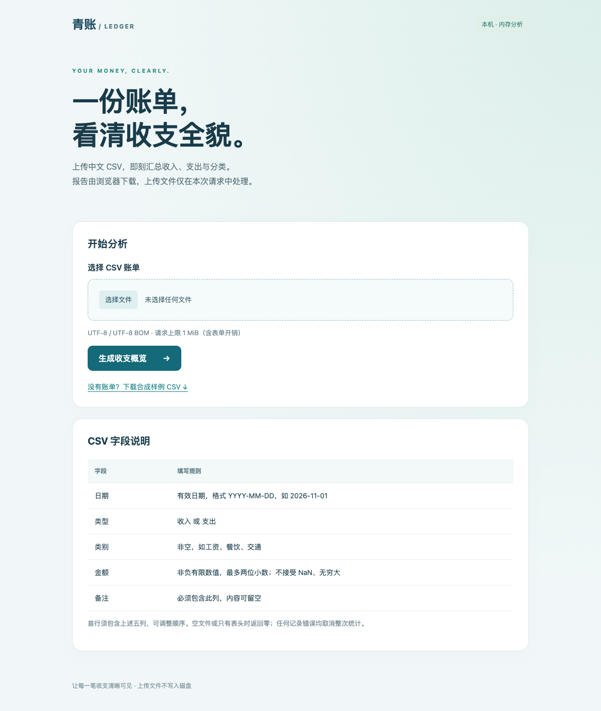
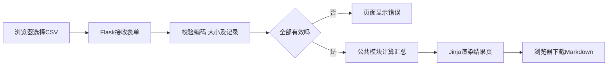
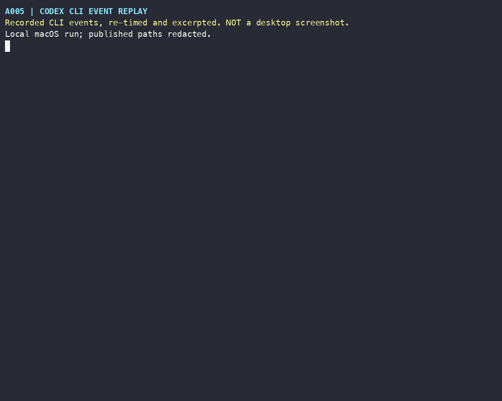
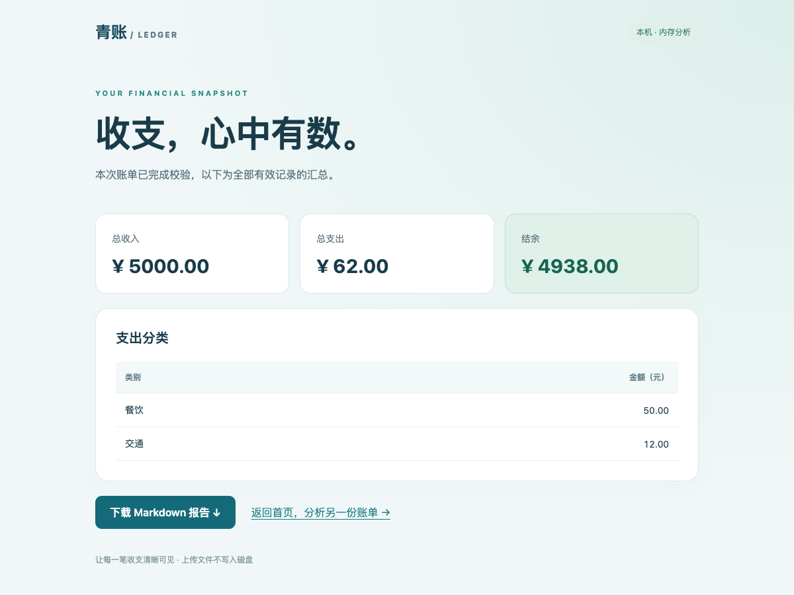
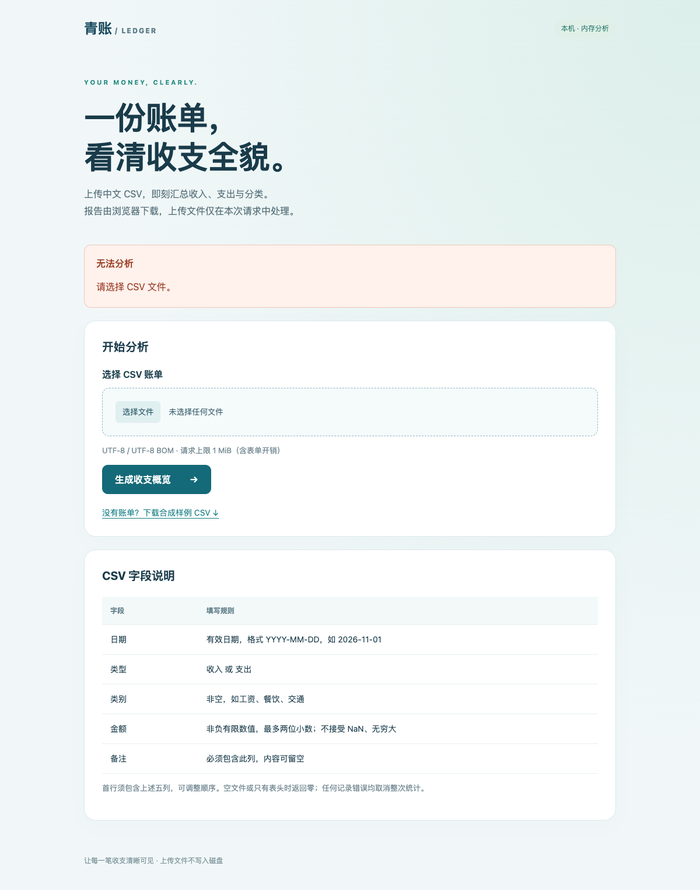
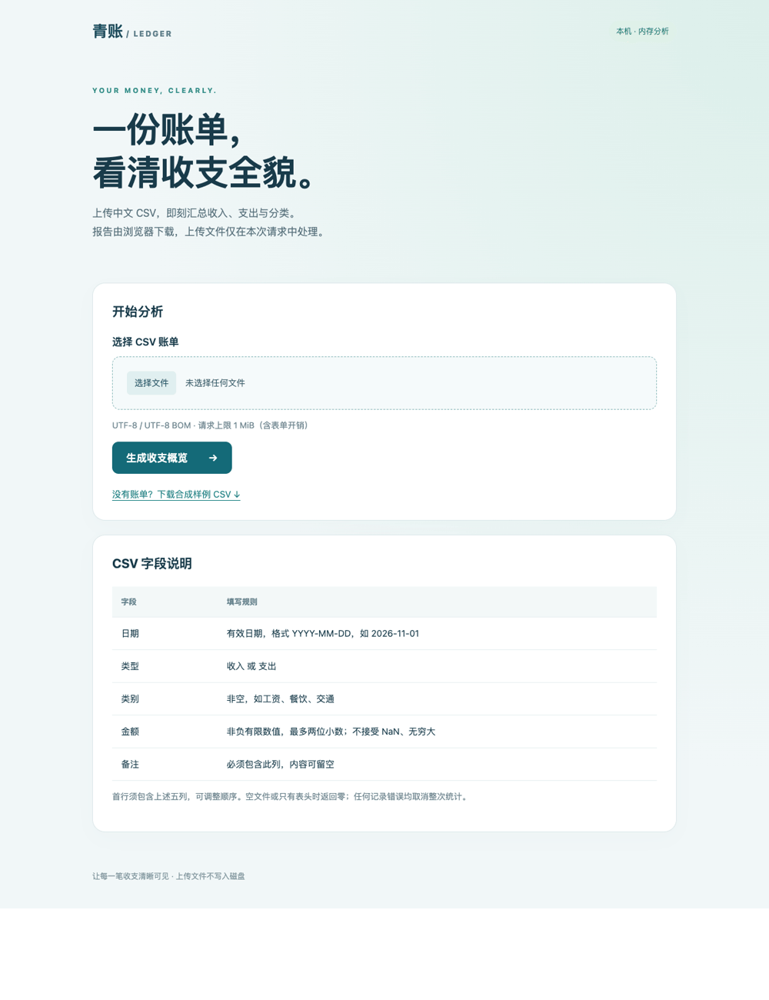

# 第5章：用 Codex 创建 Flask 网站，在浏览器里上传收支表

前四章的小工具已经能算账、导出报告，也有一组可以重跑的测试。但把它交给不习惯终端的人，对方还得记住参数、进入目录、找到输出文件。能不能把这些动作换成一个网页？

这一章，我们让 Codex 在原有计算逻辑上加一层 Flask 界面：选择合成 CSV，点击分析，查看收入、支出、结余与类别汇总，再下载报告。计算规则继续沿用前四章，网页负责接收输入和展示结果，不重新发明一套金额算法。

## 一、本章交付什么，先看网站



图1：实际运行的本地 Flask 首页，通过独立浏览器会话截图。它不是 AI 绘制的界面，也不是把静态设计稿当成已经运行的网站。

| 知识点 | 在项目中的用途 | 交付内容 |
|---|---|---|
| Flask 路由 | 接收页面访问和表单提交 | 首页与分析入口 |
| 文件上传 | 读取用户选择的 CSV | 编码、大小和字段检查 |
| 公共计算逻辑 | 让命令行与网页遵循同一规则 | 可复用的计算模块 |
| Jinja 模板 | 把金额和错误展示在页面 | 结果卡片、分类表及错误提示 |
| 浏览器验收 | 从实际使用入口检查 | 操作图片、下载文件与测试记录 |

本章是本机教学网站，不包含账号、数据库、支付或公网部署。服务器只监听 `127.0.0.1`，调试器关闭。浏览器页面可用，不等于已经具备对外运营条件。

## 二、从第四章副本准备项目

在独立项目目录复制第四章的 `ledger.py`、`sample.csv` 和 `test_ledger.py`，保留原目录。先执行原来的测试，再增加网页；这样旧行为发生变化时，才有比较依据。

本次开发中先提取公共计算模块，再运行原8项测试，确认通过后才继续做页面。不要把第四章的录制文件当作工作文件改写；本章成品放在项目的 `examples/flask-ledger`，运行证据放在独立素材目录。

为了让 Codex 明确范围，我们准备了一份简短的 `AGENTS.md`：只处理合成资料，保留 CLI 行为，网页不持久保存上传内容，不开启调试器。它是本案例的项目说明，不代表读者已经完成了一门完整的代理配置课程。

### 2.1 准备 Python 环境

跟做时进入自己的项目目录，创建虚拟环境：

```sh
python3 -m venv .venv
```

macOS 的虚拟环境解释器是 `.venv/bin/python`；Windows 通常使用 `.venv\Scripts\python.exe`，本章尚未在 Windows 实测。后续命令都要使用已经确认的那一个解释器，避免把依赖装到系统 Python、服务却用另一套环境启动。

依赖文件由本章项目提供。新环境按文件安装：

```sh
.venv/bin/python -m pip install -r requirements.txt
```

安装可能需要网络。Codex 模型调用本身也需要相应服务连接，教程费用不包含订阅和模型额度。本次机器已有 Flask，验证环境的具体版本及依赖复用方式记入验证档案；上面的新装路径不能冒充一次被录下来的安装过程。

## 三、把“做个网站”写成可以验收的任务

先看本章的工作关系：



网页层不该悄悄改变金额口径。收入和支出仍由“类型”列区分，金额为非负数，结余为输入里的收入减支出。支出分类只统计支出，日期和金额异常不能静默跳过。图中错误分支不会展示前半份数据的“成功结果”。

下面是本次实际任务的教学整理版，完整指令见[提示词附件](../assets/recordings/flask-ch05/A005/prompt.txt)：

```text
读取已有 ledger.py 和 test_ledger.py，保留 CLI 行为和原8项测试。
提取可复用计算逻辑，创建 Flask 应用、模板、样式和网页测试。
首页提供CSV上传、字段说明与样例下载。
POST /analyze 在内存里解析 UTF-8 或 UTF-8 BOM CSV，不保存上传文件。
成功显示收入、支出、结余、支出分类，并提供Markdown下载。
用Jinja安全序列化报告内容，模板保持自动转义。
请求大小限制1 MiB；缺文件、错误编码或记录错误都明确提示。
只在本机运行，关闭debug；不要启动长期服务或发布到公网。
先运行原测试，再运行网页测试。失败如实保留，不伪造结果。
```

这里没有要求模型随意挑一套前端框架。页面需要的功能已经确定，Flask、模板和少量样式足够表达。入门时减少工具数量，才能看清上传、计算和展示之间的关系。

## 四、看 Codex 实际创建和验证项目



图2：通过 Hermes `gif_codex` 工作流，把真实 `codex exec --json` 事件渲染成动图。路径经过脱敏，时间经过重排，长输出有节选。它是 CLI 事件重放，不是 Codex 应用截图；完整错误保留在证据文件里。

成品中，`app.py` 负责路由与响应，公共模块负责读取和计算，`templates` 负责 HTML，`static` 放样式。命令行程序仍然保留；我们增加一个入口，而不是把经过验证的旧入口直接扔掉。

阅读代码时，先追踪一次提交：表单把文件交给哪个路由，路由怎样解码，什么时候调用计算逻辑，有错时返回哪里。第一次不必背下所有模板标签，但要知道金额显示来自真实计算结果，而不是模板里写死的演示值。

## 五、启动服务，真正走一遍浏览器

在项目目录用虚拟环境解释器启动：

```sh
.venv/bin/python -m flask --app app run --host 127.0.0.1 --port 5055
```

终端保持运行，再访问 `http://127.0.0.1:5055/`。若端口被占用，换一个空闲端口，并同步修改浏览器地址，不要关闭来源不明的进程。结束练习时在服务终端按 Ctrl+C，页面不会因为保留在浏览器里就自动继续提供服务。

### 5.1 选择样例并提交

选择本章原始 `sample.csv`，点击表单的分析按钮。上传到这个本地服务器不是上传到一个公共网站，但仍应先用合成资料。应用不主动持久保存文件；页面中的“不写入磁盘”说明应理解为这一应用行为，框架处理较大上传时仍可能使用临时缓冲，不能推断全部处理永不触盘。也不能把本机上传等同于所有平台上的文件操作都没有数据传输。



图3：真实提交后的结果页。核对收入5000.00、支出62.00、结余4938.00；分类中餐饮50.00、交通12.00。页面好看与金额正确要分别检查。

### 5.2 下载并重新打开报告

在结果页使用下载入口，把 Markdown 保存到下载目录。重新打开，核对三项总额和类别金额。下载文件的正文应与页面一致，不能只看到浏览器出现“下载完成”便算验收。

报告由当前结果生成，不要求把上传文件长期保存在服务器。不要把“下载报告”误解为网页拥有任意读写你电脑目录的权限；浏览器的下载行为与本地脚本写入指定路径是不同入口。

### 5.3 试一次错误反馈

下面展示的是实际提交得到的错误页面：



图4：错误由实际请求触发，页面应说明问题，并允许回到正常上传流程。不能只隐藏异常堆栈，却留下上一份数据的成功结果，让读者误以为错误输入也分析成功。

1 MiB 限制针对请求大小，包含表单开销，不保证一个恰好1 MiB的文件一定能提交。日期、类型、负金额与非法小数仍按既定规则判断；这些行为应通过测试核对，而不是只展示一张首页图片。

## 六、浏览器使用演示与测试怎样互相补充



图5：真实浏览器操作阶段截图合成，非连续录像。各帧来自实际运行的网站，不是生成模型绘制的假页面。

浏览器演示检查的是实际页面能否使用；Flask 测试则覆盖更多输入与响应。两者不能互相代替：路由测试通过，不保证按钮能点击或页面金额没有被样式遮住；首页能打开，也不能证明错误输入和原CLI行为都正确。

若发现问题，追问应指出入口和实际现象：

```text
保留当前错误页面和请求结果。说明失败发生在上传、解析、计算还是模板展示。
先复现，不要改固定金额预期，不删除原CLI测试。
只修复确认的问题，完成后运行相关测试并重新走一次浏览器流程。
```

开发中首次完整测试遇到真实误判：错误页按钮也含“收支概览”，让一个宽泛的文本断言匹配到了按钮。修正为检查结果卡片标识后通过；这次改的是测试判断，不是删除输入校验。另修正了测试响应关闭问题。完整过程见[开发记录](../examples/flask-ledger/VALIDATION.md)。

本次CLI生成任务完成后，独立重跑19项测试全部通过，包括原8项CLI测试。浏览器也实际完成上传、缺失文件错误反馈和下载按钮检查，下载报告的金额与页面一致。开发中失败与修复记录保留在项目VALIDATION.md中，不能从最后的通过图片反推“从未失败”。

### 再看两个容易混淆的接口

首页是 GET 请求，分析使用 POST 请求。访问首页并不会自动读取电脑上的账单，只有选择文件并提交后，路由才从表单里接收上传对象。实际代码用 `request.files.get('file')` 查找字段；模板输入框的名称与这里不一致，就会得到“请选择 CSV 文件”，即使页面上看起来已经选中了文件。

所以出现上传失败时，先核对请求和字段，而不是先怀疑金额算法。再沿着解码、解析、计算、渲染逐步排查。错误编码属于输入解释问题，模板变量为空则可能属于数据传递问题；它们都不适合通过重装全部依赖来处理。

本章内置样例下载把两笔餐饮合并为一条50.00，因此内置下载示例为三条记录，而原四章及本章上传验证仍用四条原记录。两者总额相同，但文件内容并不相同，不能据金额一致宣称两个文件逐字一致。跟做时固定一份输入，再记录来源；不要在不同样例之间切换而忘记交代。

### 运行成功与交付成功分开核对

服务打印地址，说明监听已启动；还要通过真实浏览器操作确认页面和脚本可用。本次报告下载用的是结果页按钮触发的 Blob，不是另写一份报告文件后假装浏览器下载成功。下载内容另存于素材的 downloads 目录，浏览器验证记录保存了核对结论。

复现时可以先核对首页，再上传，再下载，不必一次排查所有环节。若首页正常而按钮无反应，查看页面脚本和事件绑定；若页面结果正确、报告却不一致，则检查报告序列化与下载内容。每一步都有自己的可检查结果，后续修改也更容易定位影响范围。

## 七、验收与迁移练习

交付前检查：原CLI仍可运行；首页能打开；样例金额正确；错误请求有清楚反馈；报告可下载并重开；没有把上传文件写成持久资料；测试与浏览器操作均有真实记录。

接下来可在合成副本中添加一类“图书”支出，先手工算好新总额，再从网页上传。不要只改页面上的数字。若想增加月份筛选、数据库或用户登录，先分别写出输入、输出和权限要求，再作为后续任务开发。

可选 AI 配图提示词：

```text
为中文Flask实操教程绘制16:9概念图：浏览器表单、Python计算模块与报告下载，
清楚展示数据流，蓝绿配色，保留标题位置。不仿造软件截图，不生成测试结果，
成图标为AI概念示意。实际执行证据由正文真实截图提供。
```

## 来源、证据与权利

技术来源：[Flask快速开始](https://flask.palletsprojects.com/en/stable/quickstart/)、[文件上传](https://flask.palletsprojects.com/en/stable/patterns/fileuploads/)。核对日期：2026年11月18日。

浏览器截图来自本章实际本机服务；CLI动图为事件重放。[项目与运行说明](../examples/flask-ledger/README.md)、[CLI时间线](../assets/recordings/flask-ch05/A005/timeline.md)、[浏览器验证](../assets/recordings/flask-ch05/A005/browser-verification.json)随本章保存。Windows未经本轮实测，正文与代码许可待作者分别登记，保持draft，不自动发布。
