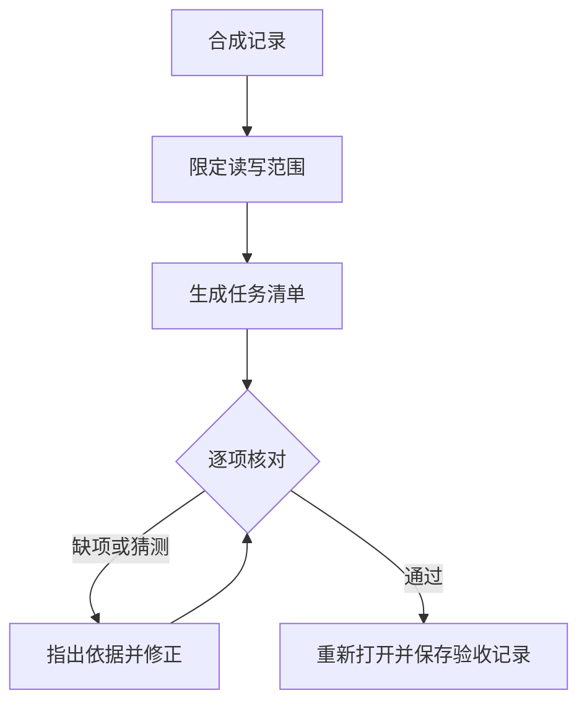

# 用 Codex 把示例记录交付为本地任务清单

和 AI 聊完，文件还没落地，任务就没有结束。这一篇，我们让 Codex 读取一份练习记录，生成 Markdown 清单，再对照原文检查。你将看到本专栏的基本路线：提出任务、审查改动、纠正问题、验收文件。

本篇为免费试读。面向能安装软件、愿意使用少量命令的读者。尚未安装的读者先按 A002 准备环境；本篇不要求先写程序。

**验证说明：以下是待复现的练习步骤和参考结果，未实际运行本篇 Codex 案例；Windows 操作待实测。**

## 一、先看清交付路线



图中的返回分支很重要。模型给出的回答再整齐，只要字段没有原文依据，就应回到输入重新核对。我们保留原记录，正是为了让修正有依据。

## 二、准备独立练习目录

需要已安装并登录的 Codex CLI，或已配置的 IDE 扩展。订阅、API 和可用额度以自己的账号及官方说明为准，购买专栏不包含这些费用。

新建空目录 `codex-first-task`，用文本编辑器创建 UTF-8 文件 `notes.txt`，写入以下合成记录，不使用真实工作材料：

```text
周五前整理图片，负责人小林。
报告由小周负责，尚未确定日期。
还有一次资料备份，负责人和日期都未定。
```

在终端进入这个目录后启动 `codex`。IDE 用户打开同一个目录，在 Codex 面板提交下方任务。两个入口的界面可能不同，以当前官方说明为准；不要因此授予额外目录权限。

## 二、让 Codex 生成文件

提交以下要求：

```text
读取当前目录 notes.txt，生成 tasks.md。
使用 Markdown 表格，列名为任务、负责人、截止时间。
只提取明确的信息，未知字段写“待确认”，保留“周五”原文。
不要修改 notes.txt，不要访问其他目录或网络，不要安装依赖。
如 tasks.md 已存在，停止并说明，不覆盖。
完成后说明生成的文件及核对方法。
```

先读执行计划和权限请求，再决定是否允许。这个任务只需要读取练习文件和新建结果文件；如果出现安装软件或访问其他目录的请求，先要求解释原因。授权提示会随客户端和配置变化，不把某个按钮名称当成固定步骤。

## 三、检查文件，而不只看回答

在编辑器打开 `tasks.md`，逐项对照 `notes.txt`。参考结果如下，并非模型实测输出：

| 任务 | 负责人 | 截止时间 |
|---|---|---|
| 整理图片 | 小林 | 周五 |
| 报告 | 小周 | 待确认 |
| 资料备份 | 待确认 | 待确认 |

应当恰好三项，不能补出日期或负责人。检查原文件是否仍与上面的三行相同，并确认目录中没有无关改动。模型说“完成”不能替代这些检查。

## 四、发现错误时怎样继续

如果出现具体日期，可以提交：

```text
tasks.md 中的具体日期没有原文依据。
请重新对照 notes.txt，仅修正 tasks.md 中无依据的信息。
保留“周五”，未知字段写“待确认”，说明修改了什么。
```

修正后重新检查整张表。若目标文件已经存在而任务停止，先检查它的来源，再指定一个未使用的新文件名；不要为了继续而覆盖旧成果。

若中文显示异常，核对输入和输出的 UTF-8 编码。若 Codex 无法读到文件，先核对当前目录和文件名，不要直接扩大权限。登录或额度问题按官方指引处理，不在提示词中粘贴凭据。

## 五、验收与练习

关闭并重新打开结果文件：中文正常、三项齐全、未知信息未被补造、原件未变、改动范围正确，才算完成。需要重试时保留旧输出，使用新文件名；本练习不需要删除原件。

再添加一条没有负责人的合成记录，让 Codex 生成另一个文件，检查它是否仍遵守规则。付费篇目会沿着这条路线扩展到脚本、文件批处理、文档和数据交付，并配套输入材料、失败处理和验收步骤。

下一篇 A002 讲安装、登录与工作目录，帮助你把练习环境固定下来。

---

技术来源核对：2026年11月18日。[Codex CLI 官方文档](https://developers.openai.com/codex/cli)、[IDE 扩展官方文档](https://developers.openai.com/codex/ide)。本篇无真实执行截图，不据此宣称已通过技术验收。

正文权利记录：作者及出版权授权待登记，未声明开放许可。本篇任务指令与示例数据供随文练习使用；后续独立代码另行标注许可。

## 补充练习：用 Python 做一次严格核对

人工检查之后，还可以使用配套 `examples/check_tasks.py`。把脚本复制到练习目录，在该目录运行 `python check_tasks.py tasks.md`；Windows 命令待实测，先确认 Python 可用。脚本只读文件，不会修正结果。

这个检查器只接受本文参考表的字段和顺序。它适合演示固定样例的回归检查，不能判断任意会议记录的语义；任务名称改写即使合理，也可能被严格检查拒绝。换输入练习时应先人工制定新的验收标准，不能机械沿用旧答案。

缺失文件、少一项任务或擅自填写日期都应返回非零退出码。看到失败先读提示，再对照原文；不要要求 Codex 修改检查器来迎合错误结果。检查器本身也是代码，需要确认它是否表达了你的真实要求。
