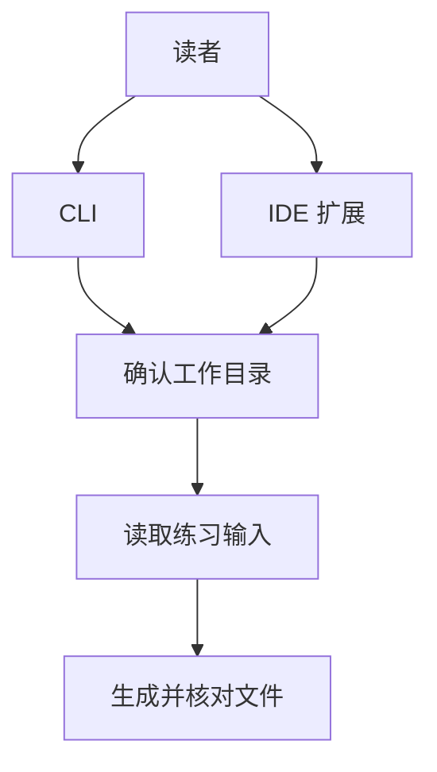

# 安装、登录与工作目录：先跑通一个小任务

第一次使用 Codex，先别把整个工作盘交给它。我们先在空目录里创建一个标记文件，确认客户端能启动、账号能使用、文件落在正确位置，再开始处理资料。

## 一、把入口和执行环境分开

CLI 是终端中的入口，IDE 扩展让我们在编辑器里提出任务、查看文件。选择入口之后，还要确认当前打开的目录。编辑器里看见文件，不等于终端也处在同一位置。



两个入口共用同一套练习目标。先选一个完成任务，再试另一个，排错时就少一个变量。

## 二、准备软件和账号

从官方 CLI 页面选择适合当前系统的安装方式。若采用 npm 路径，先确认 Node.js 和 npm 已按官方要求安装，再在终端执行：

```sh
npm install -g @openai/codex
codex --version
```

第一条安装软件，第二条只检查能否找到客户端。安装需要网络，可能涉及系统权限；不要因为失败就直接用管理员模式重试。记录完整错误和安装方式，核对官方排错说明。Windows 原生与 WSL 是不同环境，解释器、路径和安装位置不能混用。

随后运行 `codex`，按照客户端提供的登录方式完成认证。不要把口令或密钥写进提示词。版本号出现只能证明程序可启动，不能证明账号额度和网络请求正常。

IDE 路径从官方 IDE 页面进入扩展安装地址，核对发布者后安装，在编辑器中打开练习目录并完成登录。CLI 已登录不能作为 IDE 已登录的验收依据。

## 三、创建一个可以检查的结果

新建空目录 `codex-setup`，打开终端进入它，用编辑器创建 `input.txt`，内容为“安装练习”。在该目录启动客户端，提交：

```text
读取当前目录 input.txt，报告看到的文字。
仅新建 setup-result.md，写入“环境练习完成”。
若目标已存在请停止。不修改输入，不安装依赖，不访问其他目录。
```

打开输出确认正文，再看输入是否仍是原来的文字。若只收到聊天回答却没有文件，要求说明实际写入路径，不把“我已完成”作为证据。

## 四、按故障发生的位置排查

找不到命令时先关闭并重开终端，核对安装记录和可执行文件路径。登录失败时检查客户端提示和官方服务说明。文件落错位置时检查启动目录。权限失败时先确认任务是否真的需要该路径，不要一次性放开整个磁盘。

记录客户端版本、系统、入口、目录、输出文件和未解决错误。练习通过后再返回 A001；下一篇我们把任务要求写得更清楚。

## 来源、验证与权利

核对日期：2026年11月18日。[CLI 官方说明](https://developers.openai.com/codex/cli)、[IDE 官方说明](https://developers.openai.com/codex/ide)、[安全说明](https://developers.openai.com/codex/security)。具体界面、登录条件及费用以当期官方说明为准。

本文为待实测草稿。没有真实会话截图，文中失败情形为教学构造，Windows 操作未经实测。正文作者及出版权待登记，未声明开放许可；配套代码单独登记许可。
