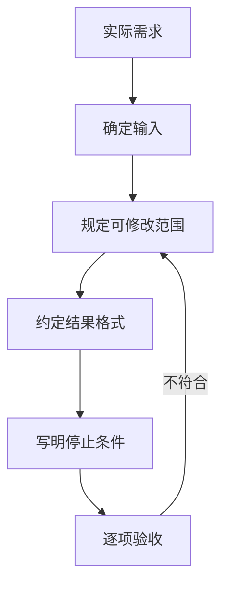

# 任务怎样写清楚：用一份记录拆开五个条件

“帮我整理一下”没有说清整理到哪里，也没有说缺失信息怎么办。结果不合用时，继续补一句“再专业一点”，通常仍然无法验收。我们拿 A001 的三条记录，把任务要求拆开写。

## 一、先给验收者留一个位置



这里的停止条件处理的是不该猜、不该覆盖的情况。它让一次任务在资料不足时停得下来。

## 二、准备输入与目标

在独立目录创建 UTF-8 的 `notes.txt`，写入 A001 的三条合成记录。新目标使用 `tasks-v2.md`，保留旧输出作对照。不要上传真实会议记录来测试一个尚未核实的流程。

先看这个构造的模糊要求：“读取记录，给我一份专业的工作计划。”它可能引入优先级、具体日期或执行建议，但原文没有这些依据。我们不需要先运行错误要求，便能发现它没有约定输出边界。

## 三、把要求落到文件和字段

```text
读取当前目录 notes.txt，仅新建 tasks-v2.md。
输出 Markdown 表格：任务、负责人、截止时间。
未知字段写待确认，周五保留原文，不添加优先级。
保留全部三项记录，不修改其他文件，不访问网络。
目标已存在、输入不存在或无法读取时停止并说明。
完成后列出实际改动及仍需人工判断的问题。
```

输入规定依据，范围规定动作，格式规定成果，停止条件处理冲突，验收则检查是否做对。它们各有用途，不需要把提示词堆成一份长协议。

## 四、信息有歧义时要求提问

如果新增记录“报告下周交”，却不知道指哪份报告，不要让模型自行合并。追加要求：遇到无法确定归属的记录先列出疑问，不写入正式表格。你确认之后再继续。

纠错也要具体。指出哪一行、哪个字段、原文依据在哪里；不要只写“不对，重新生成”。修正后仍要检查整表，因为改动可能影响其他行。

## 五、换输入检验方法是否有效

加入一项没有负责人的任务，改用另一个未使用文件名。先自己写下预期，再运行，检查是否保留未知信息。随后构造一个已有目标的情况，观察是否停止而非覆盖。操作前备份练习文件；没有实际完成测试时只记录待验证，不写“全部通过”。

下一篇讨论执行中的另一个问题：任务描述正确，是否就可以批准所有命令？

## 来源、验证与权利

核对日期：2026年11月18日。[CLI 官方说明](https://developers.openai.com/codex/cli)、[IDE 官方说明](https://developers.openai.com/codex/ide)、[安全说明](https://developers.openai.com/codex/security)。具体界面、登录条件及费用以当期官方说明为准。

本文为待实测草稿。没有真实会话截图，文中失败情形为教学构造，Windows 操作未经实测。正文作者及出版权待登记，未声明开放许可；配套代码单独登记许可。
