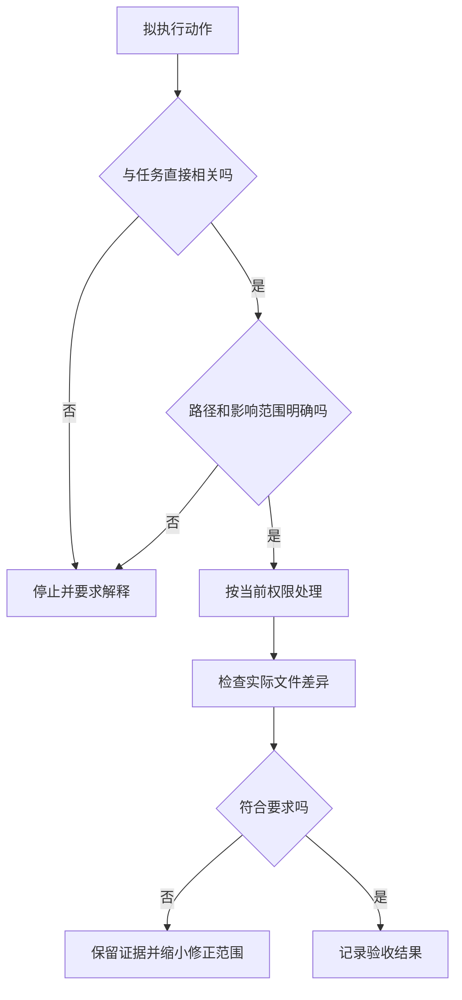

# 看懂改动与授权：执行前先问这一步要改什么

Codex 请求执行命令时，我们需要知道它将读取哪些文件、写入哪里，以及失败后留下什么。只看命令是否熟悉不够，一条常见命令也可能指向错误目录。

## 一、先分清要求和限制

提示词里的“不要修改原件”表达我们的要求，实际执行还受客户端权限和环境限制影响。不能把一句文字约束当成操作系统隔离。审查时同时检查任务、拟执行动作和实际改动。



授权前检查意图，执行后检查结果。这是两个不同的检查点。

## 二、用小目录练习审查

复制 A001 的合成输入到新练习目录，保留只读对照副本。要求生成一个新文件，不安装依赖、不联网、不处理子目录。客户端若能展示差异，逐行检查；没有差异视图就用编辑器打开输入和输出对照。

先检查路径，再检查新增和删除，最后看字段内容。新建一张正确表格却删除输入，也不满足任务要求。修改行数少也不代表修改正确，关键仍是内容依据。

## 三、遇到无关安装请求怎样处理

下面是教学构造情形，并非真实会话：整理三行纯文本时，模型提出安装大型数据处理依赖。此时可以要求：

```text
暂停安装。说明为什么当前纯文本任务需要该依赖。
优先使用已有能力完成；若无法完成，只报告阻塞原因。
不要修改环境或扩大访问目录。
```

解释合理也不等于必须安装。核对用途、来源、影响范围，再决定。任务本身需要联网时，应单独明确访问目的，不能沿用本例的离线约束。

## 四、拒绝之后继续推进

权限不足并不意味着任务必须失败。先把输入副本放到允许的练习目录，缩小目标，再重新提交。不要为了绕过提示，把同一个高影响动作藏进脚本里。

发现改错文件时停止后续动作，保存差异和日志，再决定恢复方式。尚未使用 Git 的练习保留原件副本，重新输出到新文件名；不要未经检查批量覆盖回去。Git 的恢复方法留到 A021 专门操作。

## 五、把验收写成可复查记录

记录输入文件、输出文件、实际修改、运行命令、失败原因和最终核对结论。敏感日志先脱敏，凭据不要进入文章截图或附件。

练习时准备三个构造请求：只读输入、创建新输出、删除无关目录。分别说明所需范围和你的判断理由，不执行删除请求。能解释为什么允许或停止，比记住某个授权按钮更有用。

## 来源、验证与权利

核对日期：2026年11月18日。[CLI 官方说明](https://developers.openai.com/codex/cli)、[IDE 官方说明](https://developers.openai.com/codex/ide)、[安全说明](https://developers.openai.com/codex/security)。具体界面、登录条件及费用以当期官方说明为准。

本文为待实测草稿。没有真实会话截图，文中失败情形为教学构造，Windows 操作未经实测。正文作者及出版权待登记，未声明开放许可；配套代码单独登记许可。
