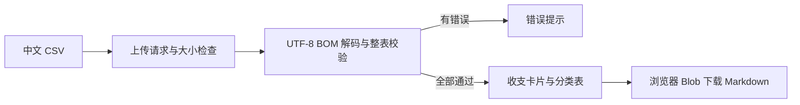

# 青账 · Flask 收支网站

将中文 CSV 在内存中汇总为收入、支出、结余和支出分类。页面使用本地 CSS，蓝绿配色，支持移动屏幕，无外部 CDN。原有 CLI 与 8 项回归测试保留，网页和 CLI 共用 `ledger_core.py`。

## 本机运行

当前环境已安装 Flask 3.1.2，无需安装包。请在本目录执行：

```sh
python3 -m flask --app app run --host 127.0.0.1 --port 5055
```

访问 `http://127.0.0.1:5055`。不启用 debug；按 Ctrl+C 结束。本练习交付时未启动长期服务。Windows 操作未经实测。

## 输入与输出

首页 `GET /` 提供上传、字段说明与合成样例下载。`GET /sample.csv` 返回带 UTF-8 BOM 的合成数据，不含真实个人账单。上传至 `POST /analyze`，表单文件字段名为 `file`。

CSV 使用 UTF-8 或 UTF-8 BOM；首行包含 `日期,类型,类别,金额,备注`，可调整顺序。日期必须为有效的 `YYYY-MM-DD`；类型为“收入”或“支出”；类别非空；金额非负、有限、最多两位小数；备注内容可空但必须有此列。空文件或仅表头返回零。沿用 CLI 规则：忽略空行，允许额外列。

缺文件、编码错误、缺列、非法日期/类型/金额均返回 HTTP 400，并显示具体错误；任何记录错误均不展示部分统计。整个上传请求上限为 1 MiB（含 multipart 表单开销），超限返回 HTTP 413，因此 CSV 应略小于 1 MiB。

上传不调用保存接口；在请求中读取与解析，不持久保存文件。自定义请求类将 multipart 文件流固定为 `BytesIO`，避免框架默认的大文件临时磁盘缓冲。

成功后显示卡片和分类表；Markdown 字符串通过 Jinja `tojson` 写入脚本，由浏览器 Blob 生成下载，不向服务器写报告。模板保持自动转义。下载报告保留用户类别原文，作为文本使用；若交给其他 Markdown 渲染器，应使用该渲染器的安全模式。



## CLI 与验证

```sh
python3 ledger.py --input sample.csv
python3 ledger.py --input sample.csv --output report.md
python3 -m unittest -v
```

CLI 的报告输出只创建新文件，拒绝覆盖。测试使用 Flask 测试客户端，不启动服务；覆盖路由、正常上传、BOM、空表、缺失输入、编码、非法字段、超限、整表失败及 HTML 转义。后续独立浏览器已实际验证上传、错误反馈、页面和下载按钮，详见本章证据。

## 版权与代码许可

正文出版权及生成代码许可待作者分别登记。生成时自动给出的MIT声明已经审阅移除，不能代替作者授权。
